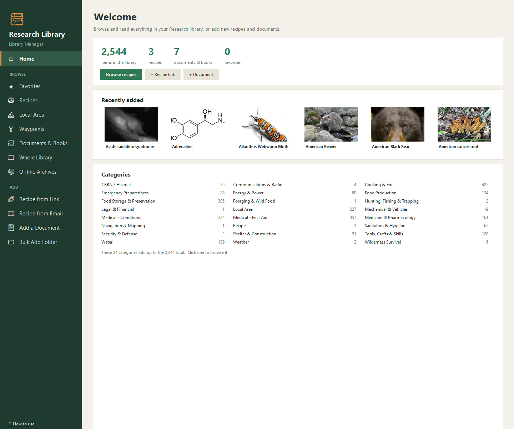
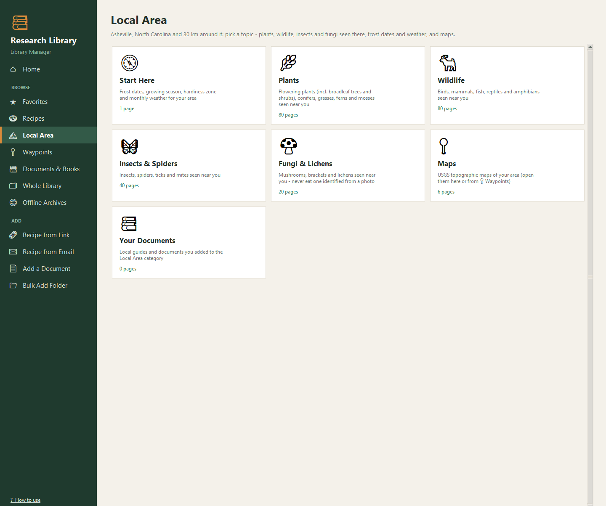
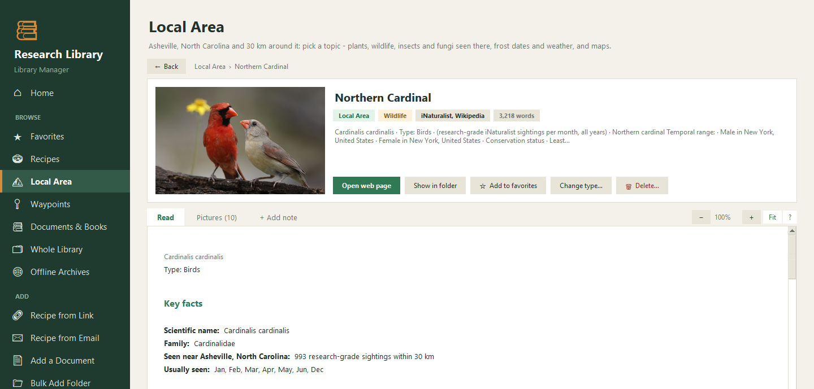
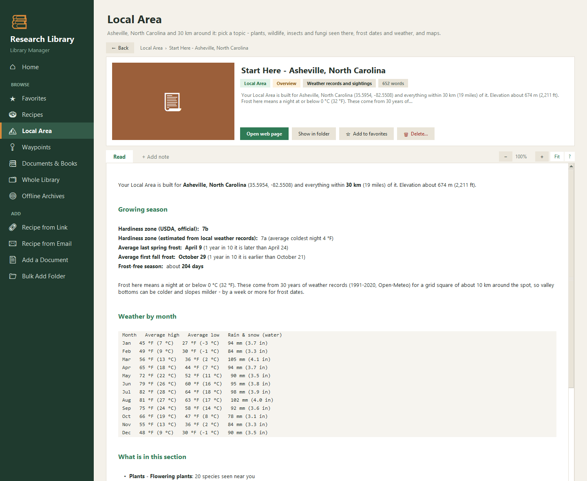
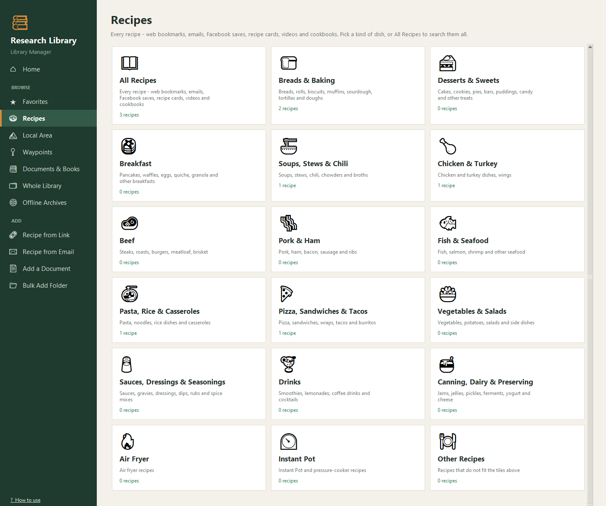
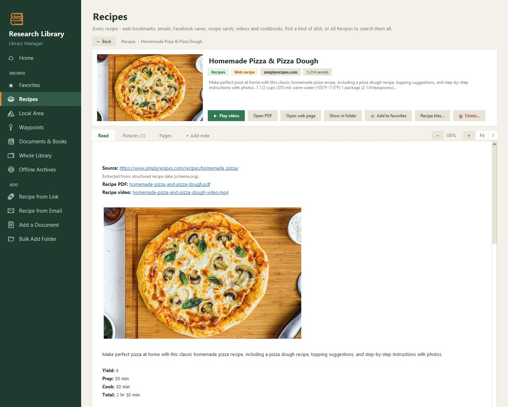
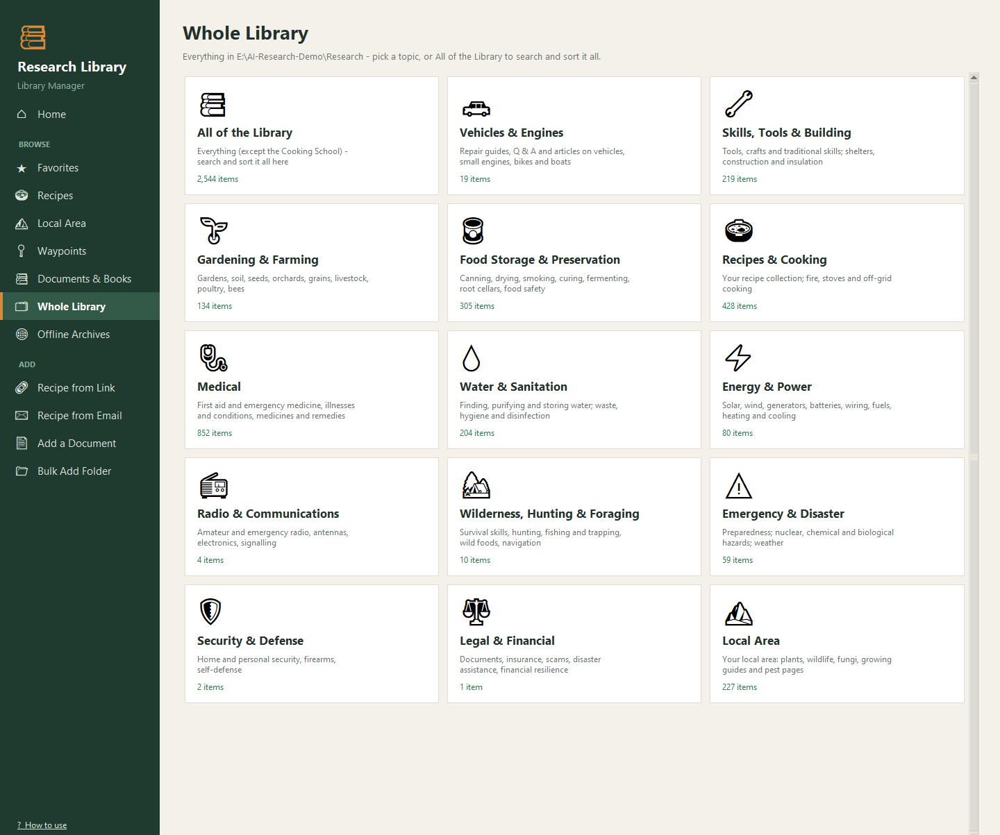

# Research Library

Your own offline reference library: practical how-to material (water, food, medicine, energy, repairs, survival
skills, recipes…) that you collect and keep on your own computer, readable without the internet.

**Library Manager** is the window you use to add things, browse by category, search every word, and read pages,
PDFs and videos. The library starts **empty**. You fill it with your own choices:

- your own documents and PDFs,
- recipes and web pages from links,
- Wikipedia articles,
- and, if you like, ready-made **starter packs**: about 15,000 hand-picked articles from free sources (Wikipedia,
  iFixit, MedlinePlus, Stack Exchange and more) that another library was built from.

Everything stays as plain files (one Markdown page per item, with its original PDF and pictures beside it), so
nothing is locked inside an app.

## What it looks like

<table>
<tr><td width="50%"><br><sub>Home: totals, recently added, every category</sub></td><td width="50%"><br><sub>Local Area made by Build Local Area for Asheville, NC</sub></td></tr>
<tr><td width="50%"><br><sub>A species page: photo, key facts, when it is seen nearby</sub></td><td width="50%"><br><sub>Start Here: frost dates, growing season, hardiness zone, weather</sub></td></tr>
<tr><td width="50%"><br><sub>Recipes, sorted onto tiles by kind of dish</sub></td><td width="50%"><br><sub>A recipe saved from a link: photo, PDF and video</sub></td></tr>
<tr><td width="50%"><br><sub>The whole library on topic tiles</sub></td></tr>
</table>

*Pictures from a demo library built from scratch with these tools (starter-pack samples, a few recipes, a Local Area for Asheville, NC).*

---

## How the apps fit together

There are four separate downloads. They work on their own, and better together when they sit side by side in
one folder.

| App | What it is | Do you need it? |
|---|---|---|
| **AIPortable** | Offline AI chat with your library, Wikipedia viewer and offline maps | Pick **one** of the two AI apps |
| **AIPortable-JustAI** | The same AI chat without the maps and Wikipedia viewer (smaller) | Pick **one** of the two AI apps |
| **Research** (this one) | The library itself and Library Manager | Optional - adds a big searchable library to the AI |
| **LibraryViewer** | A read-only copy of the library for an Android tablet | Optional |

Most people use **either** AIPortable **or** JustAI, not both. Research and LibraryViewer are add-ons: the AI apps
search the Research library when it sits next to them, and LibraryViewer shows the same library on a tablet.

Put the ones you use in **one folder**, side by side:

```
AI-Research\
    AIPortable\          (or AIPortable-JustAI\)
    Research\            this library
    LibraryViewer\       optional
```

The apps find each other by that layout. The folder can be anywhere (another drive, a USB drive). Avoid
OneDrive-synced folders.

---

## Setting up from scratch

**You need:** Windows 10 or 11, an internet connection for setup, and disk space for the library: a few GB
for your own material, more for the starter packs (see below).

1. **Get the folder.** Download this repository (green **Code** button → *Download ZIP*, then unzip), or with git:
   `git clone https://github.com/DFranke84/Research`. Put it next to your AI app as shown above.
2. **Double-click `Setup.bat`.** It installs everything Library Manager needs: Python 3.14 (if missing), its
   packages (about 400 MB, first time only), and a desktop shortcut. It offers two optional extras:
   Chrome or Edge (for clean one-page recipe PDFs) and Git for Windows (for reading old Word `.doc` files).
   Safe to run again at any time, for example after moving the folder.
3. **Start Library Manager** from the desktop shortcut or `Library Manager.vbs`.

A new library shows its categories with nothing in them yet. The first thing you add creates the catalog, and
everything else (search, the AI apps' link to the library, the tablet viewer) follows from it.


**Testing a fresh install?** [TESTING.md](TESTING.md) is a step-by-step checklist for setting all the apps up from scratch in a test folder - no experience needed.

---

## Categories: where things go

Every item lives in exactly one category, and each category is a folder. The categories are about what the
material helps you **do**. The library comes with these 24, ready to use:

| Category | Folder | Code | What goes in it |
|---|---|---|---|
| Water | `water` | `W` | Finding, collecting, purifying, storing and testing water: wells, rainwater, filters, distillation |
| Food Storage & Preservation | `food-storage-preservation` | `FS` | Canning, drying, smoking, curing, fermenting, root cellars, long-term storage, food safety |
| Food Production | `food-production` | `FP` | Gardening, soil, seed saving, orchards, grains, livestock, poultry, bees, fish farming |
| Foraging & Wild Food | `foraging-wild-food` | `FW` | Wild edible plants and how to forage safely |
| Hunting, Fishing & Trapping | `hunting-fishing-trapping` | `HF` | Hunting, trapping, snares, fishing, butchering and processing game |
| Cooking & Fire | `cooking-fire` | `CF` | Starting fires, fuels, stoves, cookware, cooking without power or outdoors |
| Recipes | `recipes` | `RC` | Recipes and cookbooks: breads, meals, baking, fermented foods, jams, seasonings, drinks |
| Medical - First Aid | `medical-first-aid` | `MA` | First aid, wounds and trauma, CPR, bites and stings, heat and cold injuries |
| Medical - Conditions | `medical-conditions` | `MC` | Illnesses and infections, long-term conditions, mental health, teeth, pregnancy and children |
| Medicine & Pharmacology | `medicine-pharmacology` | `MP` | Medicines and how to use them, antibiotics, vaccines, medical supplies, herbal remedies |
| Sanitation & Hygiene | `sanitation-hygiene` | `SH` | Toilets and waste, keeping clean, disinfecting, pest and insect control |
| Shelter & Construction | `shelter-construction` | `SC` | Shelters, building methods and materials, insulation, earth, timber and masonry building |
| Energy & Power | `energy-power` | `EP` | Solar, wind, small hydro, generators, batteries, wiring, fuels, heating and cooling |
| Tools, Crafts & Skills | `tools-crafts-skills` | `TC` | Hand tools, knives, woodworking, metalworking, knots, sewing, leather, soap making, traditional skills |
| Mechanical & Vehicles | `mechanical-vehicles` | `MV` | Engines, vehicle care and repair, small engines, bicycles, boats, keeping equipment running |
| Communications & Radio | `communications-radio` | `CR` | Amateur and emergency radio, antennas, electronics, signalling, emergency alerts |
| Navigation & Mapping | `navigation-mapping` | `NM` | Maps, compass, finding your way on land, navigating by the stars, GPS |
| Wilderness Survival | `wilderness-survival` | `WS` | Bushcraft, survival manuals, cold, desert and sea survival, signalling for rescue |
| Emergency Preparedness | `emergency-preparedness` | `EM` | Kits and plans, evacuation, getting ready for storms, floods, fires, earthquakes, outages, pandemics |
| CBRN / Hazmat | `cbrn-hazmat` | `CB` | Nuclear, radiation, chemical and biological hazards, fallout, decontamination, protective gear |
| Security & Defense | `security-defense` | `SD` | Self-defense, home and personal security, firearms, scams and online security |
| Weather | `weather` | `WX` | Forecasting, reading the sky, seasons, weather hazards |
| Legal & Financial | `legal-financial` | `LF` | Important documents, insurance, fraud and scams, disaster assistance, money matters |
| Local Area | `local-area` | `-` | Your own area: weather, plants, wildlife and maps - built by `Build Local Area.bat` (see below), plus local documents you add |

**How it is used.** When you add something, Library Manager reads it and suggests the best-fitting category
(you can always pick another). The codes are what the command-line tools below expect, e.g. `--category W`. The
Home page and the browse pages show every category with how many items it holds, and `LIBRARY.md` lists the
counts too.

**Changing the categories.** Best decided before you add much. They are defined in three places in `_scripts`:

1. `categories.py` - one line per category: the folder name and a one-line description. Add, rename or remove
   a line here.
2. `common.py` - `CODES`, the short code for each folder (used by the command-line tools).
3. `50_ingest_folder.py` - `KW`, the words that make Add a Document suggest that category (optional: without
   them the category is never suggested, but you can still pick it).

If a category already has items, add the new category first, move the items into it with Library Manager's
**Change category…** button (it updates each page and the catalog), and only then remove the old line.

---

## Filling your library

### Your own files

In Library Manager:

- **Add a Document**: one file - PDF, Word (`.docx`/`.doc`), `.odt`, `.rtf`, `.txt`, `.md`, a saved web
  page, an `.epub` e-book or `.pptx` slides. It checks for duplicates, reads scanned pages with OCR, suggests a
  title and category (you can change both) and keeps the original beside a searchable copy.
- **Bulk Add Folder**: a whole folder at once. You see every file marked *New*, *Already in library*,
  *Almost the same*, *Doesn't fit the library topics*… before anything is added, and you tick what goes in.

### Recipes

- **Recipe from Link**: paste a recipe's web address. You get just the recipe (title, photo, ingredients,
  steps) as a page plus a clean one-page PDF; video links (YouTube, Facebook, TikTok…) are saved as the video.
- **Recipe from Email**: for Microsoft Outlook users - move a recipe email into an Outlook folder named
  **Email › Recipes**, then type a few words of its subject.

### Web pages, PDFs and Wikipedia articles from links

These run from a command window opened in the `Research` folder (`P` stands for
`_scripts\.venv\Scripts\python`):

| To add | Command |
|---|---|
| Web pages (any site) | `P _scripts\68_add_web_page.py --category EM https://www.ready.gov/kit` |
| PDFs from links (direct `.pdf` links or archive.org pages) | `P _scripts\69_add_pdf_link.py --category W https://…/manual.pdf` |
| Wikipedia articles | `P _scripts\67_add_wiki_articles.py "Solar still:W" "Rainwater harvesting:W"` |

Each takes a list file too (`--file list.txt`, one link per line). The letters are category codes: `W` water,
`FS` food storage, `FP` food production, `MA` first aid, `MC` medical conditions, `MP` medicine, `EP` energy,
`TC` tools & skills, `EM` emergency preparedness … (the full list is at the top of `_scripts\common.py`).
Web pages come from the live site, or from the Internet Archive if the site blocks or has moved the page.

### Starter packs (optional)

The packs are the choices another library was built from. Take all of them, some, or none.

| Pack | Items | What you download first |
|---|---:|---|
| Wikipedia articles | 2,359 | nothing - fetched from wikipedia.org (about 2 hours), **or** a Wikipedia archive (see below) |
| iFixit repair guides | 4,491 | iFixit archive, 3.6 GB |
| Stack Exchange Q&A (13 sites: DIY, gardening, cooking, outdoors, mechanics…) | 4,264 | one archive per site, 28 MB - 2.1 GB |
| MedlinePlus (health topics, drugs, encyclopedia) | 1,270 | MedlinePlus archive, 1.9 GB |
| Appropedia (appropriate technology, DIY) | 1,034 | 0.6 GB |
| WikEM (emergency medicine) | 545 | 0.4 GB |
| energypedia (off-grid energy) | 171 | 0.8 GB |
| NHS Medicines | 154 | 15 MB |
| Wikibooks (whole how-to books) | 61 | 3.5 GB |
| Web pages & PDFs from public sites (home food preservation, CDC, Ready.gov, Army manuals…) | 929 | nothing - downloaded one by one (a few hours) |

1. **`Get Archives.bat`** lists the archives with their sizes and downloads the ones you pick from
   [Kiwix](https://kiwix.org) (always the current version). Downloads can be stopped and continued, and each
   file is checked before use. They go to `_sources\zim`.
2. **`Build Starter Library.bat`** lists the packs and builds the ones you pick into library pages, with their
   pictures. Building from an archive is quick (minutes); Wikipedia and the web pack take hours because every page
   is fetched separately. You can stop and run it again - finished items are skipped.

> **Wikipedia may slow you down.** wikipedia.org limits how fast one computer may fetch pages ("throttling").
> For a large batch - the Wikipedia pack, or Build Local Area with many species - it can make the tools wait
> minutes at a time, and a page that still won't come is skipped (run the tool again later to fill it in).
> **To be sure, download Wikipedia first:** in `Get Archives.bat` pick **Wikipedia - text only** (about 53 GB) or
> **Wikipedia - with pictures** (about 127 GB). When a Wikipedia archive is in `_sources\zim`, both tools take the
> articles from it instead - no limits, no internet needed for that part. (With the text-only archive the
> articles come without their pictures; species pages still get their iNaturalist photos.)

The archives are useful on their own as well: Library Manager's **Offline Archives** page reads them directly,
and the AI apps can search them while answering (the 🗃️ button).

---

## Using the library with the AI app

In AIPortable or JustAI: **🛠️ Tools/Settings → Library → Sync Research Library**. The app indexes this folder where it is
(nothing is copied) and from then on can answer from it (the 📚 button). Run Sync again after adding things.
If the library is not next to the app, use **Change folder…** there.

The tablet viewer (LibraryViewer) is built from the same folder - see its own README.

---

## Your Local Area (optional)

**`Build Local Area.bat`** makes the Local Area section for where **you** live. It asks for a town or address
(or a position such as `35.59, -82.55`), how far around it to look (50 km is a good start), and how many species
to take per group (100 is the default - the most often seen first). Then it builds:

| Part | What you get | Where it comes from |
|---|---|---|
| **Start Here** | Average last spring and first fall frost (and how late or early they can be), length of the growing season, hardiness zone, average highs, lows and rain for every month | 30 years of weather records for your spot ([Open-Meteo](https://open-meteo.com)); the official USDA zone too in the US |
| **Plants** | Flowering plants (including broadleaf trees and shrubs), conifers, grasses and sedges, ferns and mosses | Species people have actually recorded near you on [iNaturalist](https://www.inaturalist.org) (research-grade sightings), each with photos, the months it is seen there and its Wikipedia article |
| **Wildlife** | Birds, mammals, fish, reptiles and amphibians | the same |
| **Insects & Spiders** | Insects; spiders, ticks and mites | the same |
| **Fungi & Lichens** | Mushrooms, brackets and lichens (with a warning never to eat one identified from a photo) | the same |
| **Maps** (US only) | USGS 1:24,000 topographic maps - the maps **📍 Waypoints** puts your own named places on | [USGS The National Map](https://apps.nationalmap.gov) |
| **AIPortable map** | A "My area" region in AIPortable's offline map list (Tools/Settings → Maps → Download maps) | if AIPortable sits next to the library |

Library Manager then shows Local Area (and Waypoints, when there are maps) with tiles for these topics.
About 1,000 species pages take an hour or so; you can stop and run it again - finished pages are skipped.
Each page includes the species' Wikipedia article, so wikipedia.org's limits apply here too - for many species,
download a Wikipedia archive first (see the note under *Starter packs*). Running
it for a different place replaces the old section (the old pages go to the Recycle Bin). Add your own local
documents - extension guides, planting calendars, local regulations - with **Add a Document**, category
**Local Area**; they show under **Your Documents**.

Works anywhere in the world, except the topographic maps (US only) and the official zone (US only - elsewhere the
zone is estimated from the weather records).

---

## Parts built for one person's setup

- The first owner's own Local Area (Kalispell / Flathead County, Montana) was put together by hand from local
  sources and is not part of the download; `Build Local Area.bat` makes a new one for your own area.
- **Recipe from Email** needs Microsoft Outlook.

---

## Where things are kept

| In the Research folder | What |
|---|---|
| Category folders (`water\`, `recipes\`, `medical-first-aid\`, …) | The library: one `.md` page per item, its original file and a `<name>_images\` folder beside it |
| `CATALOG.csv` / `CATALOG.json` | The list of every item (the CSV opens in Excel) |
| `LIBRARY.md` | A summary of your library (counts per category and source), rewritten after every change |
| `_sources\zim\` | Downloaded Kiwix archives |
| `_work\` | Favorites, notes, settings, review reports and build logs |
| `starter\` | The starter pack lists |
| `_scripts\` | Library Manager and its tools, and its Python environment (`.venv`) |

Your notes are `.txt` files beside each item; favorites are in `_work\favorites.json`.

## Licenses and sharing

Every page records its source and license at the top of its `.md` file. Free sources are mostly CC BY-SA
(Wikipedia, Stack Exchange, Appropedia…) or public domain (US government works); iFixit is non-commercial only.
Pages saved from other websites and your own documents are for personal offline use - check before sharing them.

The Library Manager code itself is free to use, change and share under the [MIT License](LICENSE).

---

**More detail** on every Library Manager page (browsing, reading, notes, favorites, moving and deleting items,
troubleshooting): [README - Library Manager.md](README%20-%20Library%20Manager.md).
